<picture>
  <source media="(prefers-color-scheme: dark)" srcset="assets/banner-dark.svg">
  
</picture>

I build tools for **listening to nature** — spectrogram viewers, bird call detectors and
on-device inference — and spend the rest of my time on **live audio for the stage** and
**FPV / drone hardware**. Based in Dresden, Germany.

&nbsp;If my tools save you time, sponsoring helps me keep them maintained.

### 🌱 Projects

| | Project | What it is |
|---|---|---|
| 🎧 | **[SignaVis](https://github.com/LimitlessGreen/SignaVis)** · [demo](https://limitlessgreen.github.io/SignaVis/demo/labeling-app.html) | Interactive waveform + spectrogram player for audio analysis and annotation — runs on the web, in Jupyter, Streamlit and Gradio. |
| 🛩️ | **[FCBase](https://github.com/LimitlessGreen/FCBase)** · [site](https://limitlessgreen.github.io/FCBase/) | Open, community-maintained database of flight controllers for ArduPilot, PX4 and iNAV — searchable and comparable. |
| 🎭 | **[StageSync](https://github.com/LimitlessGreen/StageSync)** | Real-time spatial soundscape engine for theatre: sound objects on a stage map, node graph, VST3 plugins, OSC control. *Work in progress.* |
| 📡 | **[OpenHD](https://github.com/OpenHD/OpenHD)** | Open-source long-range digital FPV video link — contributor. |

### 🐦 Currently exploring

- Bird call **detection** with object-detection models (BirdBox) on top of BirdNET
- Running **BirdNET V3** on phone NPUs
- Feedback suppression and room calibration for live sound

### 🧰 Toolbox

  

Banner: a real spectrogram of synthesized audio — a dawn chorus, an exponential sine sweep, FM synthesis, a Fourier series, a sinc function and “LimitlessGreen” written into the sound — see <a href="scripts/make_banner.py"><code>scripts/make_banner.py</code></a>.
